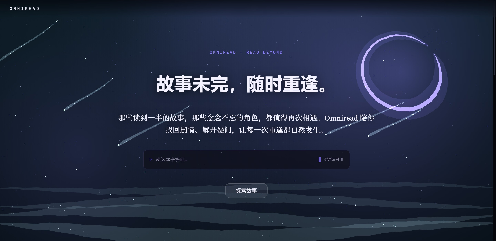
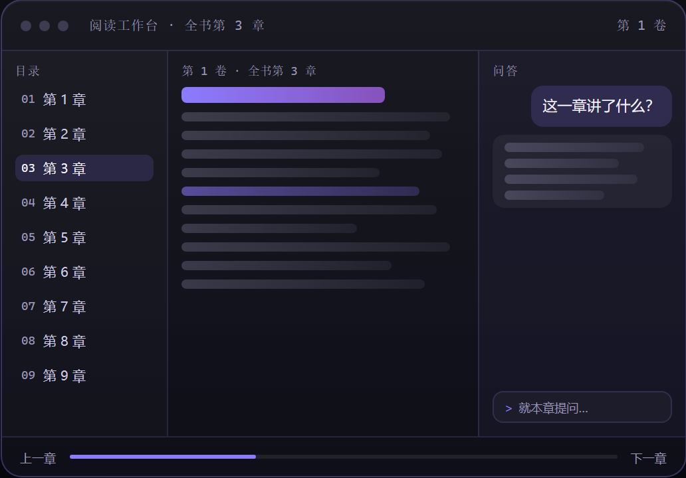
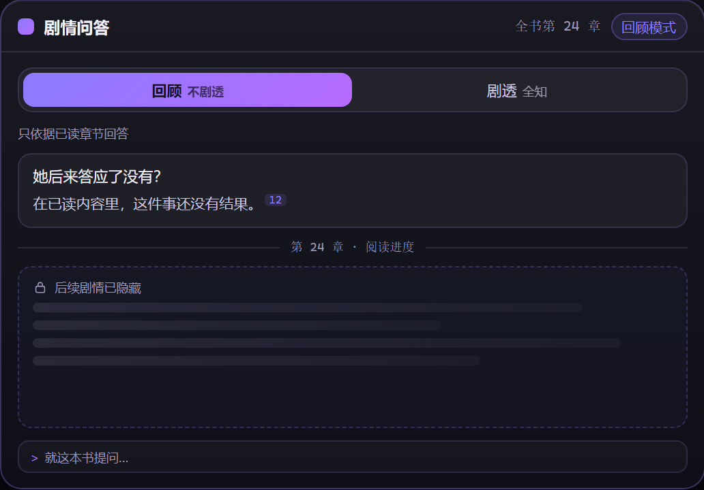
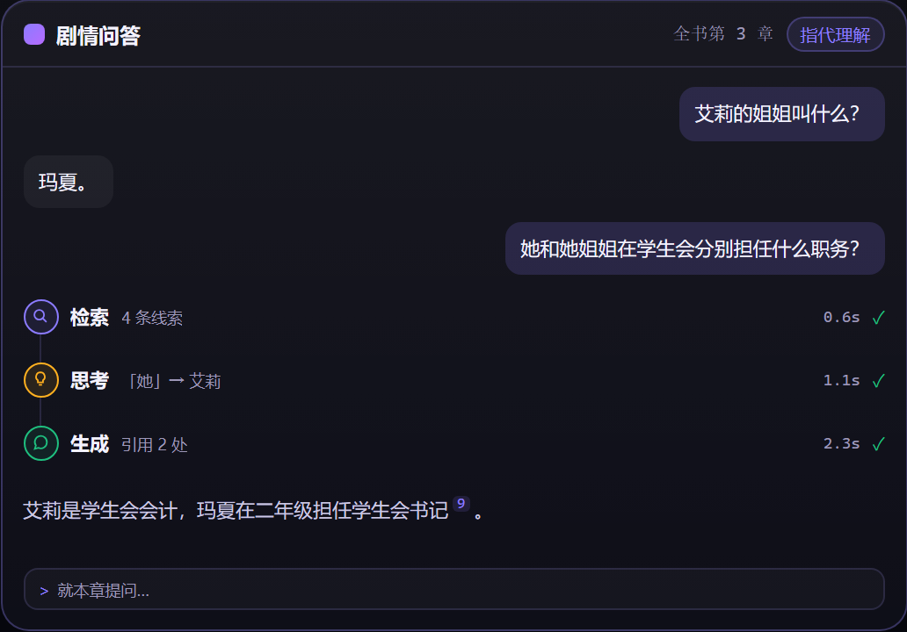
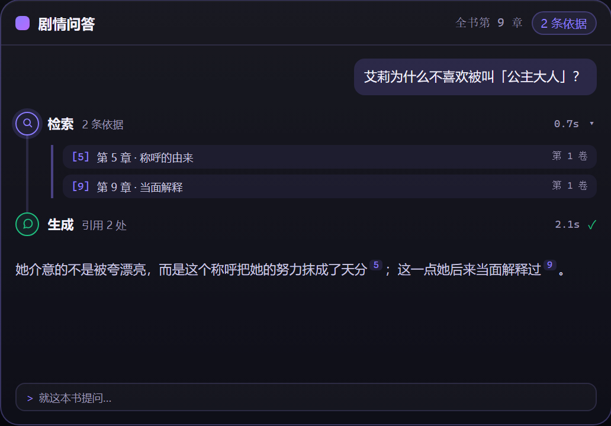

# Omniread

**故事未完，随时重逢。**



那些读到一半的故事，那些念念不忘的角色，都值得再次相遇。
Omniread 陪你找回剧情、解开疑问，让每一次重逢都自然发生。

阅读页放着原文，旁边随时可以提问。每一个回答都标出它依据的章节，点角标就能跳回那一章。

**[→ 在线体验](https://dreamcloude.com)**　账户由管理员发放，暂不开放注册。

---

## 阅读不该是一场与遗忘的赛跑

忘记了前面的剧情，不必反复翻找；遇到陌生的人物与复杂的关系，不必在章节间来回跳转。
Omniread 把 AI 放进阅读过程里，让你随时找回故事脉络、理解人物与情节，也能自由决定探索故事的深度。

- **随时接续** —— 忘记了人物是谁，或记不清之前发生了什么？让 AI 帮你回顾关键剧情与人物信息，不必重新翻阅整段故事。
- **随时探讨** —— 一个称呼、一段对话，也可能藏着复杂的人物关系。直接提问，AI 结合原文理解指代、梳理线索，让难懂的剧情有迹可循。
- **自由探索** —— 想重温已经读过的情节，还是提前了解后续发展？自由选择回顾或剧透，让 AI 按你的阅读需求展开讨论。

## 四项能力

### 01 · 阅读与 AI 对话，无缝衔接



随时阅读，随时提问。不用切换页面，也不用打断阅读节奏，让 AI 成为你的专属阅读搭档。

### 02 · 想知道多少，由你决定



想重温已读剧情，还是提前探索后续发展？自由切换回顾与剧透模式，按自己的阅读节奏获取信息，既能守住惊喜，也能满足好奇。

### 03 · 告别剧情遗忘与指代混淆



无需反复翻阅前文，即使只记得一个模糊的称呼、一段零散的情节，也能直接提问。AI 结合小说内容理解上下文，消除指代歧义，帮你理清人物关系、回顾关键剧情，让每一次阅读都能自然接续。

### 04 · 不止回答问题，更能找到原文依据



想知道的剧情、人物与细节，都可以直接提问。AI 结合小说内容检索相关线索，并展示引用依据，让每一次解答都有迹可循。

## 三条不会让步的底线

- **答不了就说答不了** —— 材料不足时明确拒答，不猜、不编。
- **每一句都找得到出处** —— 结论挂章节角标，点开就是那一段原文。
- **读有边界，问无边界** —— 阅读沿你的进度展开，问答覆盖整本书。

## 开始使用

- **在线体验**：[dreamcloude.com](https://dreamcloude.com)
- **本地运行**：

  ```bash
  bash scripts/dev-up.sh --fake-providers --web
  ```

  起 PostgreSQL / 检索 / 问答 / 前端全栈；`--fake-providers` 用假模型跑通链路，零调用费用。

<sub>Java 25 · Spring Boot · Python 3.13 · Vue 3 · PostgreSQL + pgvector</sub>
